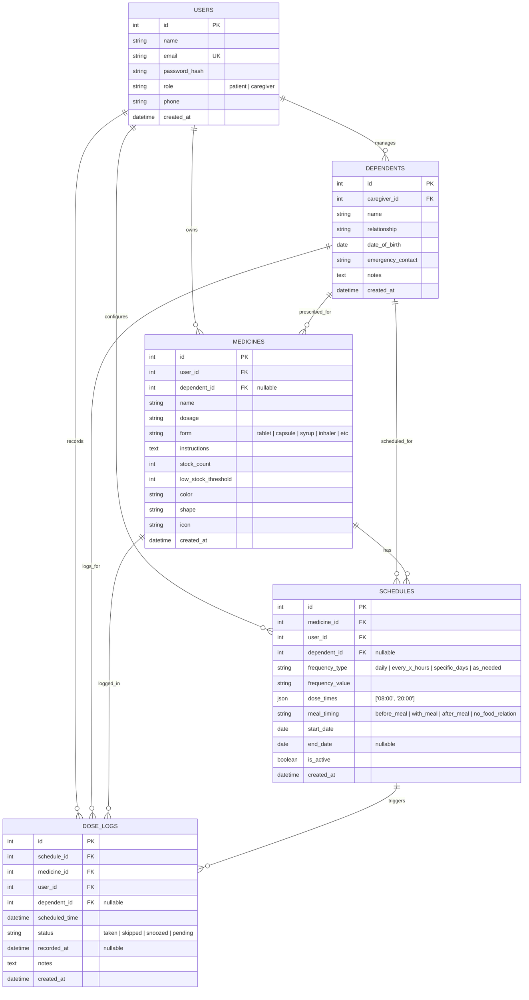

# MediRemind — Entity Relationship Diagram (ERD) & Database Specification

**Project Title:** MediRemind — Cross-Platform Medicine & Prescription Reminder  
**Team Name:** Beergin  
- **Project Manager:** Jerold Sodusta  
- **Back-End Developer:** Francis John Empil  
- **Front-End Developer:** Jibson Cabilin  
- **Quality Assurance:** Nove Calasang  
**Submitted To:** Mr. Henzon Paul Dionsay  
**Date:** October 12, 2026  

---

## 1. Visual Entity Relationship Diagram (ERD)

---

## 2. Table DDL Definitions (PostgreSQL)

See full PostgreSQL DDL script located at:
[`backend/src/db/schema.sql`](file:///C:/Users/User/Desktop/mediremind/backend/src/db/schema.sql)
