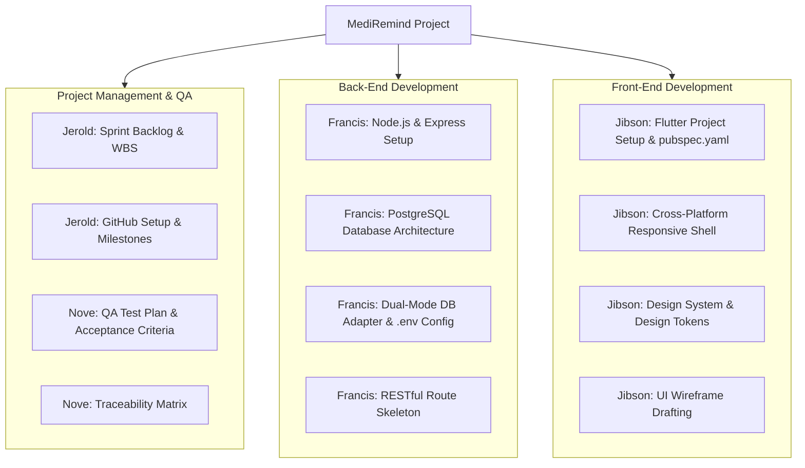

# MediRemind — Week 1 Deliverables: Requirements & Planning Package

**Project Title:** MediRemind — Cross-Platform Medicine & Prescription Reminder  
**Team Name:** Beergin  
- **Jerold Sodusta** — Project Manager  
- **Francis John Empil** — Back-End Developer  
- **Jibson Cabilin** — Front-End Developer  
- **Nove Calasang** — Quality Assurance  
**Submitted To:** Mr. Henzon Paul Dionsay  
**Date of Submission:** October 12, 2026  
**Document Status:** Complete & Approved (Week 1 Milestone Deliverable)

---

## 1. Executive Summary & Objective

The primary objective of **Week 1 (Requirements and Planning)** is to establish a rigorous architectural and operational foundation for **MediRemind**, ensuring that all functional scopes, technical constraints, team roles, version control workflows, and project schedules are formally specified and agreed upon prior to core implementation.

---

## 2. Finalized Software Requirements Specification (SRS)

### 2.1 Functional Requirements (FR)

| ID | Module | Requirement Description | Priority |
| :--- | :--- | :--- | :--- |
| **FR-01** | **Authentication** | The system must allow users to register and log in securely using email and password, returning a signed JWT with 7-day validity. Passwords must be hashed using `bcrypt` (min 10 salt rounds). | **Must Have** |
| **FR-02** | **Role Distinction** | The system must support two user roles: `patient` (manages personal medication) and `caregiver` (manages personal medication and linked dependents). | **Must Have** |
| **FR-03** | **Medicine CRUD** | Users must be able to create, view, update, and delete prescription medications, including drug name, dosage (e.g. 500mg), form (tablet, capsule, syrup, inhaler, etc.), color/shape tags, and instructions. | **Must Have** |
| **FR-04** | **Inventory & Stock** | The system must track remaining pill/unit stock, decrement count by 1 upon dose confirmation, and raise a visual warning when stock falls below `low_stock_threshold`. Users can refill (+30/+60) with one tap. | **Must Have** |
| **FR-05** | **Dose Scheduling** | The system must support recurrence rules: Daily, Every X hours, and Specific Days of the week, with meal association (before meal, with meal, after meal, no food relation) and custom time slots. | **Must Have** |
| **FR-06** | **Dose Logging** | The system must compute today's dose timeline and allow marking doses as `taken`, `skipped`, or `snoozed` (15-min deferral), timestamping actual consumption. | **Must Have** |
| **FR-07** | **Adherence Engine** | The system must compute compliance percentage: `(Taken / Total Scheduled) * 100`, calculate consecutive 100% adherence day streaks, and generate downloadable CSV reports. | **Must Have** |
| **FR-08** | **Caregiver View** | Caregivers must be able to link dependent family members (e.g., elderly parents, children) and switch context to manage their schedules independently. | **Should Have** |

### 2.2 Non-Functional Requirements (NFR)

| ID | Category | Metric / Specification |
| :--- | :--- | :--- |
| **NFR-01** | **Offline Capability** | All core reminder checking, local logging, and UI displays must function 100% offline without active internet, running against local storage / localhost. |
| **NFR-02** | **Performance** | API responses on `localhost:5000` must return in `< 100ms`. UI clock ticker must update every 1000ms with zero frame drops. |
| **NFR-03** | **Accessibility (WCAG 2.1 AA)** | UI must use high-contrast color pairings, large legible font sizes, and minimum 44x44 px touch targets tailored for elderly or visually impaired patients. |
| **NFR-04** | **Data Integrity** | Cascade deletion rules must ensure that deleting a medicine safely purges orphan schedules and dose records. |
| **NFR-05** | **Audio Alert Reliability** | Web Audio API synthesizer must produce audible two-tone chime alerts without external file network dependencies. |

---

## 3. Work Breakdown Structure (WBS) & Task Assignments

### 3.1 Responsibility Assignment Matrix (RACI)

| WBS Task | Jerold (PM) | Francis (BE) | Jibson (FE) | Nove (QA) |
| :--- | :---: | :---: | :---: | :---: |
| Requirements & Scope Definition | **Accountable** | Consulted | Consulted | Responsible |
| GitHub Repository & Branching Rules | **Responsible** | Informed | Informed | Informed |
| Backend Architecture & Express Scaffolding | Informed | **Responsible** | Consulted | Informed |
| Database Engine & Schema Configuration | Informed | **Responsible** | Informed | Consulted |
| Flutter Scaffolding & Directory Setup | Informed | Consulted | **Responsible** | Informed |
| Responsive Shell & Simulator Design | Informed | Informed | **Responsible** | Consulted |
| QA Test Plan & Verification Matrix | Consulted | Informed | Informed | **Responsible** |
| Deliverable Compilation for Mr. Dionsay | **Responsible** | Consulted | Consulted | Consulted |

---

## 4. GitHub Repository & Version Control Strategy

### 4.1 Branching Model (Feature-Branch Workflow)
- **`main`**: Production-ready branch. Only merges from `develop` via Pull Request after QA sign-off.
- **`develop`**: Integration branch for current milestone testing.
- **`feature/<module-name>`**: Individual feature branches (e.g. `feature/auth-jwt`, `feature/flutter-dashboard`, `feature/dose-logging`).
- **`bugfix/<ticket-id>`**: Targeted defect resolutions.

### 4.2 Pull Request (PR) Policy
1. Every PR requires at least **1 peer review** (Francis reviews BE, Jibson reviews FE).
2. Automated lint and smoke verification must pass with zero build errors.
3. PR template must specify: *Summary of changes*, *Module affected*, and *Screenshots/Test evidence*.

---

## 5. 13-Week Master Project Schedule & Milestones

| Wk | Milestone Focus | Back-End (Francis) | Front-End (Jibson) | QA & PM (Jerold & Nove) | Deliverable Artifact |
| :-: | :--- | :--- | :--- | :--- | :--- |
| **1** | **Requirements & Planning** | Initial Express structure & DB setup | Flutter setup & UI requirements | Finalized SRS, WBS, GitHub repo | [`WEEK_1_DELIVERABLES.md`](file:///C:/Users/User/Desktop/mediremind/docs/WEEK_1_DELIVERABLES.md) |
| **2** | **System Design & Prototypes** | ERD, PostgreSQL schema, API specs | Wireframes, navigation flow, mockups | Test plan & design review | [`WEEK_2_DELIVERABLES.md`](file:///C:/Users/User/Desktop/mediremind/docs/WEEK_2_DELIVERABLES.md) |
| **3** | **Authentication** | Registration/login, bcrypt, JWT | Auth screens with form validation | Auth test suite & integration | Auth Module |
| **4** | **Medicine Management** | Medicine CRUD & stock tracking | Medicine catalog & modal forms | CRUD API verification tests | Medicine Module |
| **5** | **Medicine Refinements** | Error handling & refill endpoints | Connect UI to live REST API | Defect report & validation | Refill & CRUD V2 |
| **6** | **Prescription Scheduling** | Schedule recurrence rules | Schedule creator & time pickers | Scheduling test matrix | Scheduler Module |
| **7** | **Dashboard & Live Doses** | Today's doses & countdown queries | Dashboard timeline & live timer | End-to-end dose tests | Live Dashboard |
| **8** | **Dose Logging & Snooze** | Taken/Skipped/Snooze endpoints | Action buttons & history list | Dose persistence audit | Dose Log Engine |
| **9** | **Local Reminders** | Reminder data payload support | Local notification & audio chime | Alert timing verification | Alert Subsystem |
| **10** | **Adherence Reports** | Adherence algorithms & CSV export | Compliance charts & summary view | Calculation audit vs ground truth| Analytics Engine |
| **11** | **Caregiver & Dependents** | Linked dependent queries & ACL | Caregiver profile switching | Access control tests | Caregiver Portal |
| **12** | **System Integration** | Performance tuning & API bug fixes | UI polish & responsive review | Full regression & user manual | Final User Manual |
| **13** | **Final Demo & Sign-off** | Live backend & DB demonstration | Multi-platform app presentation | Final presentation & report | Complete MediRemind System |

---

## 6. Technical Stack Setup Verification (Week 1 Milestones)

### 6.1 Back-End Initial Architecture Setup
- **Directory:** [`backend/`](file:///C:/Users/User/Desktop/mediremind/backend)
- **Server:** Node.js v24.15.0 + Express v4.19.2 ([`server.js`](file:///C:/Users/User/Desktop/mediremind/backend/server.js))
- **Environment:** Configured in [`.env`](file:///C:/Users/User/Desktop/mediremind/backend/.env) (port, secrets, DB drivers)
- **Database Architecture:** Dual-engine adapter supporting PostgreSQL 18 with persistent fallback.

### 6.2 Front-End Initial Architecture Setup
- **Directory:** [`flutter_app/`](file:///C:/Users/User/Desktop/mediremind/flutter_app) & [`frontend/`](file:///C:/Users/User/Desktop/mediremind/frontend)
- **Flutter Manifest:** [`pubspec.yaml`](file:///C:/Users/User/Desktop/mediremind/flutter_app/pubspec.yaml) (configured with `flutter_local_notifications`, `http`, `provider`, `intl`)
- **Responsive Web Client:** HTML5 + CSS3 + JS PWA with mobile handset frame simulator.
