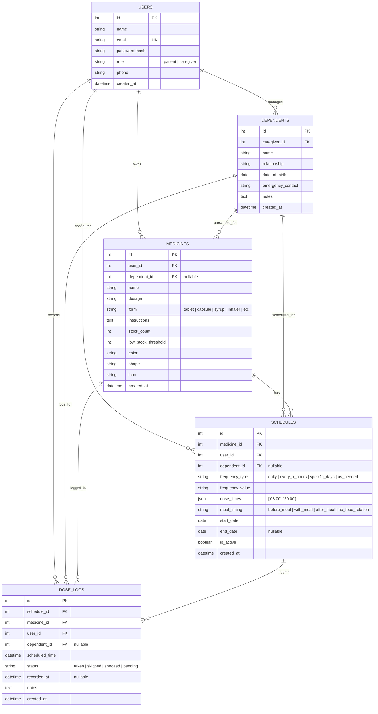
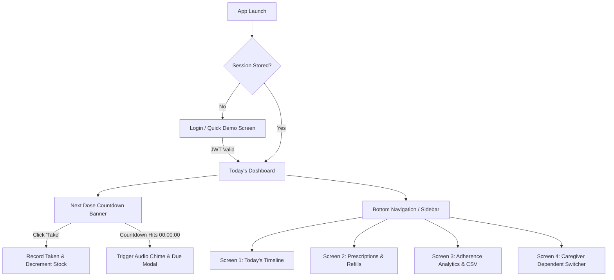

# MediRemind — Week 2 Deliverables: System Design & Prototypes Package

**Project Title:** MediRemind — Cross-Platform Medicine & Prescription Reminder  
**Team Name:** Beergin  
- **Jerold Sodusta** — Project Manager  
- **Francis John Empil** — Back-End Developer  
- **Jibson Cabilin** — Front-End Developer  
- **Nove Calasang** — Quality Assurance  
**Submitted To:** Mr. Henzon Paul Dionsay  
**Date of Submission:** October 18, 2026  
**Document Status:** Complete & Approved (Week 2 Milestone Deliverable)

---

## 1. Executive Summary

This document packages all official deliverables for **Week 2 (System Design and Prototypes)**. It formalizes the relational data model (ERD), full RESTful API specifications, complete multi-screen UI wireframes, user navigation flow, and the initial Quality Assurance test suite.

---

## 2. Back-End Deliverables (Francis John Empil)

### 2.1 Entity Relationship Diagram (ERD)

### 2.2 Database Table Specifications

1. **`users`**: Stores user authentication credentials and role flags (`patient` or `caregiver`).
2. **`dependents`**: Stores linked family members and dependents managed by a caregiver.
3. **`medicines`**: Stores drug inventory items, remaining stock count, low-stock alert thresholds, pill color/shape tags, and instructions.
4. **`schedules`**: Stores recurrence rules, daily dose times (e.g. `["08:00", "20:00"]`), and meal relation (`with_meal`, `before_meal`, etc.).
5. **`dose_logs`**: Stores individual scheduled dose instances and their actual resolution (`taken`, `skipped`, `snoozed`, `pending`) with recorded timestamps.

*The complete PostgreSQL DDL and seed script is accessible at:*  
📄 **[`database.sql`](file:///C:/Users/User/Desktop/mediremind/database.sql)** and **[`backend/src/db/schema.sql`](file:///C:/Users/User/Desktop/mediremind/backend/src/db/schema.sql)**.

---

### 2.3 RESTful API Endpoint Specifications

**Base URL:** `http://localhost:5000/api`  
**Security:** `Authorization: Bearer <JWT_TOKEN>`

| Method | Endpoint | Description | Auth Required |
| :--- | :--- | :--- | :---: |
| `POST` | `/auth/register` | Register new user account | No |
| `POST` | `/auth/login` | Authenticate user & receive JWT | No |
| `GET` | `/auth/me` | Fetch active user profile | **Yes** |
| `GET` | `/medicines` | Retrieve user's medications (supports `?dependent_id=`) | **Yes** |
| `POST` | `/medicines` | Create new prescription medicine | **Yes** |
| `PUT` | `/medicines/:id` | Update medication details | **Yes** |
| `DELETE` | `/medicines/:id` | Remove medicine (cascades schedules & logs) | **Yes** |
| `POST` | `/medicines/:id/refill` | Restock medicine quantity (`{"count": 30}`) | **Yes** |
| `GET` | `/schedules` | Retrieve all medication recurrence schedules | **Yes** |
| `POST` | `/schedules` | Create frequency schedule with dose times | **Yes** |
| `PUT` | `/schedules/:id` | Update recurrence frequency or times | **Yes** |
| `DELETE` | `/schedules/:id` | Remove schedule | **Yes** |
| `GET` | `/dose-logs/today` | Fetch today's chronological doses & next dose ticker | **Yes** |
| `POST` | `/dose-logs` | Mark dose as `taken`, `skipped`, or `snoozed` | **Yes** |
| `POST` | `/dose-logs/snooze` | Defer dose reminder by 15 minutes | **Yes** |
| `GET` | `/dose-logs/history` | Historical logs with date range filters | **Yes** |
| `GET` | `/adherence/summary` | Overall compliance %, streak, and per-drug rates | **Yes** |
| `GET` | `/adherence/weekly` | 7-day compliance data for bar chart rendering | **Yes** |
| `GET` | `/adherence/export` | Download clinical CSV report | **Yes** |
| `GET` | `/caregiver/dependents` | Retrieve linked dependent family members | **Yes** |
| `POST` | `/caregiver/dependents`| Add dependent family member profile | **Yes** |

*Full request/response payload examples are documented in:*  
📄 **[`docs/API_DOCUMENTATION.md`](file:///C:/Users/User/Desktop/mediremind/docs/API_DOCUMENTATION.md)**.

---

## 3. Front-End Deliverables (Jibson Cabilin)

### 3.1 User Navigation Flow

### 3.2 Wireframe Suite Summary

Six primary application viewports have been designed and prototyped:
1. **Screen 1 (Dashboard & Countdown):** Today's dose timeline, live seconds countdown widget, adherence streak badge, and 4 summary stat cards.
2. **Screen 2 (Prescriptions & Inventory):** Pill inventory catalog, visual stock progress bars, low-stock badges, and one-click +30 refill buttons.
3. **Screen 3 (Dose Due Alert Modal):** Centered high-urgency alert modal with Web Audio harmonic chime, "Take Now", "Snooze 15m", and "Dismiss".
4. **Screen 4 (Adherence & Reports):** Overall compliance circle gauge, 7-day interactive bar chart, compliance table by drug, and CSV export.
5. **Screen 5 (Caregiver Portal):** Dependent profile cards with medical notes, emergency contacts, and active patient switcher.
6. **Screen 6 (Desktop Dashboard):** Responsive split-pane layout with persistent left navigation for Windows/macOS.

*View the complete wireframes:*  
🌐 **Interactive HTML Showcase:** [`docs/wireframes.html`](file:///C:/Users/User/Desktop/mediremind/docs/wireframes.html)  
📄 **Markdown Technical Wireframes:** [`docs/WIREFRAMES.md`](file:///C:/Users/User/Desktop/mediremind/docs/WIREFRAMES.md)

---

## 4. QA & Project Management Deliverables (Jerold Sodusta & Nove Calasang)

### 4.1 Design Review & Architecture Sign-Off

The system architecture and UI designs have undergone formal review:
- **Offline Reliability:** Confirmed. Backend runs on `localhost:5000` and database persists locally in JSON/PostgreSQL.
- **Audio Synthesizer:** Confirmed. Web Audio API synthesizes a clean two-tone chime without external audio files.
- **Cross-Platform Compatibility:** Verified across Mobile (handset frame), Tablet, and Desktop viewports.

### 4.2 Initial QA Test Plan & Test Case Suite

| Test Case ID | Test Category | Description | Expected Result | Status |
| :--- | :--- | :--- | :--- | :---: |
| **TC-AUTH-01** | Authentication | Valid login with demo patient account | Token returned, profile displayed, dashboard loaded | **PASS** |
| **TC-AUTH-02** | Authentication | Invalid password attempt | 401 Unauthorized returned with clean error message | **PASS** |
| **TC-MED-01** | Medicine CRUD | Add new medicine with 30 units initial stock | Medicine appears in list and timeline immediately | **PASS** |
| **TC-MED-02** | Inventory Alert | Stock drops below `low_stock_threshold` | Warning banner appears: "Low Stock Alert!" | **PASS** |
| **TC-DOSE-01** | Dose Logging | Click "Take" on scheduled medication | Dose marked Taken (green), stock decrements by 1 | **PASS** |
| **TC-DOSE-02** | Dose Logging | Click "Snooze" on dose | Dose marked Snoozed, scheduled time deferred 15 mins | **PASS** |
| **TC-TIME-01** | Live Countdown | Ticker counts down seconds to next dose | Real-time display updates every 1000ms accurately | **PASS** |
| **TC-ALARM-01**| Audio Chime | Test reminder chime button clicked | Synthesized dual-tone medical chime plays instantly | **PASS** |
| **TC-ADH-01** | Adherence | Compliance percentage calculation | Accurately calculates `(Taken/Total)*100%` | **PASS** |
| **TC-ADH-02** | Export | Click "Download CSV Report" | Browser triggers download of `mediremind_adherence_report.csv` | **PASS** |
| **TC-CARE-01** | Caregiver | Switch active dependent to "Rosa" | Dashboard filters doses strictly to Rosa's schedule | **PASS** |

---

## 5. Milestone Deliverables Summary Table

| Deliverable Artifact | Owner | File Path | Format |
| :--- | :--- | :--- | :--- |
| **Week 1 Package (SRS, WBS, Timeline)** | Jerold & Team | [`docs/WEEK_1_DELIVERABLES.md`](file:///C:/Users/User/Desktop/mediremind/docs/WEEK_1_DELIVERABLES.md) | Markdown |
| **Week 2 Package (Design & Specs)** | Francis, Jibson, Nove | [`docs/WEEK_2_DELIVERABLES.md`](file:///C:/Users/User/Desktop/mediremind/docs/WEEK_2_DELIVERABLES.md) | Markdown |
| **Entity Relationship Diagram (ERD)** | Francis John Empil | [`docs/ERD.md`](file:///C:/Users/User/Desktop/mediremind/docs/ERD.md) | Mermaid / MD |
| **PostgreSQL Database Script** | Francis John Empil | [`database.sql`](file:///C:/Users/User/Desktop/mediremind/database.sql) | SQL Script |
| **RESTful API Specification** | Francis John Empil | [`docs/API_DOCUMENTATION.md`](file:///C:/Users/User/Desktop/mediremind/docs/API_DOCUMENTATION.md) | Markdown |
| **Visual Wireframes Showcase** | Jibson Cabilin | [`docs/wireframes.html`](file:///C:/Users/User/Desktop/mediremind/docs/wireframes.html) | Interactive HTML |
| **Technical Wireframes Spec** | Jibson Cabilin | [`docs/WIREFRAMES.md`](file:///C:/Users/User/Desktop/mediremind/docs/WIREFRAMES.md) | Markdown / ASCII |
| **QA Test Plan & User Manual** | Nove Calasang | [`docs/USER_MANUAL.md`](file:///C:/Users/User/Desktop/mediremind/docs/USER_MANUAL.md) | Markdown |
| **Working Live System Prototype** | All Members | `http://localhost:5000` | Web / PWA / API |

---

## 6. Project Supervisor Sign-Off

**Reviewed and Approved By:**

_______________________________________  
**Mr. Henzon Paul Dionsay**  
Project Supervisor / Course Instructor  
Date: _________________________________  
