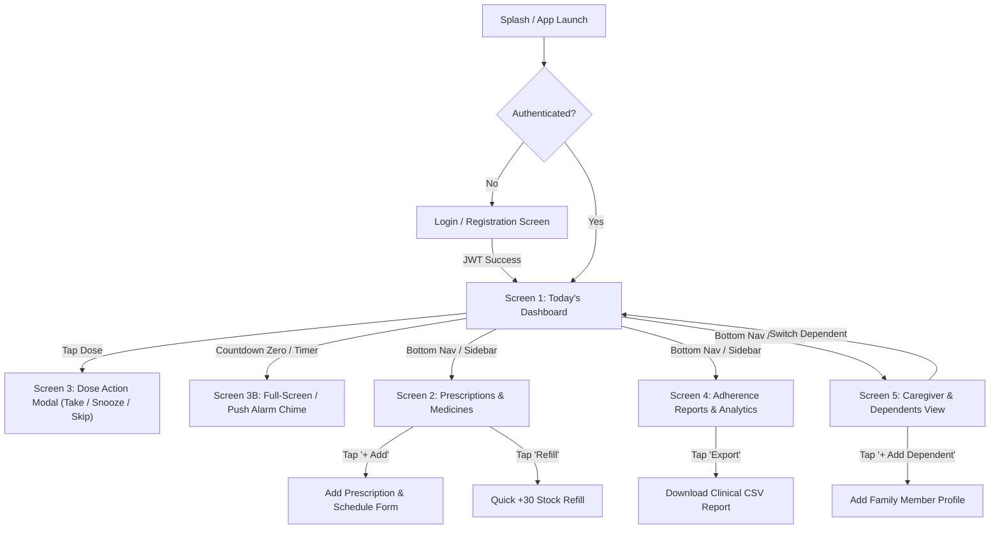

# MediRemind — UI/UX Wireframe Specifications

**Project Title:** MediRemind — Cross-Platform Medicine & Prescription Reminder  
**Team Name:** Beergin  
- **Project Manager:** Jerold Sodusta  
- **Back-End Developer:** Francis John Empil  
- **Front-End Developer:** Jibson Cabilin  
- **Quality Assurance:** Nove Calasang  
**Submitted To:** Mr. Henzon Paul Dionsay  
**Date:** October 18, 2026  
**Document Version:** 1.0 (Phase 1 Deliverable)

---

## 1. User Journey & Navigation Flow



---

## 2. Low-Fidelity / Mid-Fidelity Screen Layouts

### Screen 1: Mobile Dashboard & Today's Timeline (Patient View)

```text
+------------------------------------------+
|  09:41                             [WiFi]|
+------------------------------------------+
|  💊 MediRemind                 🔔 [Avatar]|
|  Hello, Maria Elena 👋                   |
|  Monday, October 12, 2026                |
+------------------------------------------+
|  [====================================]  |
|  | UP NEXT: Metformin (500mg)         |  |
|  | Scheduled 08:00 AM • With Meal     |  |
|  |                                    |  |
|  |       [ 01:24:32 remaining ]       |  |
|  |                                    |  |
|  |          [ ✓ Mark Taken ]          |  |
|  [====================================]  |
+------------------------------------------+
|  TODAY'S DOSES (3 of 4 Completed - 75%)  |
|                                          |
|  +------------------------------------+  |
|  | 08:00 AM | [💊] Metformin 500mg    |  |
|  | With breakfast        [ ✓ Taken ]  |  |
|  +------------------------------------+  |
|  | 08:00 AM | [💊] Lisinopril 10mg    |  |
|  | Before meal           [ ✓ Taken ]  |  |
|  +------------------------------------+  |
|  | 01:00 PM | [🧴] Multivitamin       |  |
|  | After lunch           [ ✓ Taken ]  |  |
|  +------------------------------------+  |
|  | 08:00 PM | [💊] Atorvastatin 20mg  |  |
|  | Bedtime dose                       |  |
|  |   [ ✓ Take ] [ ⏰ Snooze ] [ Skip ] |  |
|  +------------------------------------+  |
+------------------------------------------+
|   [📅 Today]  [💊 Meds]  [📊 Stats]  [👥] |
+------------------------------------------+
```

---

### Screen 2: Prescription & Inventory Management

```text
+------------------------------------------+
|  < Back     Prescriptions       [+ New]  |
+------------------------------------------+
|  [Search medicines...              🔍]   |
+------------------------------------------+
|  ACTIVE PRESCRIPTIONS (4)                |
|                                          |
|  +------------------------------------+  |
|  | [💊] Metformin                     |  |
|  | 500 mg • Tablet                    |  |
|  | Times: 08:00 AM, 07:00 PM          |  |
|  | Stock: [========--] 28/40 pills    |  |
|  | [+ Refill 30]             [Edit/🗑️]|  |
|  +------------------------------------+  |
|                                          |
|  +------------------------------------+  |
|  | [💊] Lisinopril                    |  |
|  | 10 mg • Tablet                     |  |
|  | Times: 08:00 AM                    |  |
|  | Stock: [==--------] 4 pills ⚠️ LOW  |  |
|  | [+ Refill 30]             [Edit/🗑️]|  |
|  +------------------------------------+  |
+------------------------------------------+
|   [📅 Today]  [💊 Meds]  [📊 Stats]  [👥] |
+------------------------------------------+
```

---

### Screen 3: Dose Due Alarm Modal (With Audio Chime)

```text
+------------------------------------------+
|  ======================================  |
|  |               ( 🔔 )               |  |
|  |                                    |  |
|  |     TIME FOR YOUR MEDICATION!      |  |
|  |                                    |  |
|  |        Metformin — 500 mg          |  |
|  |    1 Tablet • Take with meal       |  |
|  |                                    |  |
|  |    [ ✓ MARK AS TAKEN ]             |  |
|  |    [ ⏰ SNOOZE (15 MINUTES) ]       |  |
|  |    [ Skip This Dose ]              |  |
|  ======================================  |
+------------------------------------------+
```

---

### Screen 4: Adherence Analytics & 7-Day Compliance

```text
+------------------------------------------+
|  Adherence Analytics         [📥 Export]  |
+------------------------------------------+
|  +------------------------------------+  |
|  |           96% ADHERENCE            |  |
|  |     🔥 5 Days Current Streak       |  |
|  |   68 Taken  •  2 Skipped  •  0 Miss|  |
|  +------------------------------------+  |
|                                          |
|  LAST 7 DAYS COMPLIANCE                  |
|  100% |  [█]  [█]  [█]  [█]  [█]  [█]    |
|   75% |                            [█]   |
|   50% |                                  |
|    0% |  Mon  Tue  Wed  Thu  Fri  Sat Sun|
|                                          |
|  MEDICINE BREAKDOWN                      |
|  • Metformin 500mg:    96% (27/28 doses) |
|  • Lisinopril 10mg:   100% (14/14 doses) |
|  • Atorvastatin 20mg:  93% (13/14 doses) |
+------------------------------------------+
|   [📅 Today]  [💊 Meds]  [📊 Stats]  [👥] |
+------------------------------------------+
```

---

### Screen 5: Caregiver View (Linked Dependents)

```text
+------------------------------------------+
|  Caregiver Dashboard    [+ Add Person]   |
+------------------------------------------+
|  Active Patient: [ Grandmother Rosa ▼ ]  |
+------------------------------------------+
|  DEPENDENT STATUS:                       |
|  • Rosa (Grandmother, 78 y/o)            |
|    Condition: Hypertension & Diabetes    |
|    Today: 2 of 2 Taken (100% on track)   |
|    Emerg: +63 917 555 1234               |
|                                          |
|  • Timmy Santos (Son, 9 y/o)             |
|    Condition: Pediatric Asthma           |
|    Today: Inhaler PRN                    |
+------------------------------------------+
|  [ Switch to Manage Rosa's Prescriptions]|
+------------------------------------------+
|   [📅 Today]  [💊 Meds]  [📊 Stats]  [👥] |
+------------------------------------------+
```

---

### Screen 6: Desktop Responsive Dashboard (Windows / macOS)

```text
+------------------------------------------------------------------------------------------------+
| [💊 MediRemind]             | Search medicines, schedules...                   | 🔔 Maria (Pt) |
+-----------------------------+------------------------------------------------------------------+
|                             | Good Day, Maria Elena 👋                       [+ New Rx] [🔔 Sound] |
| 📅 Today's Doses (Active)   | Monday, October 12, 2026                                         |
| 💊 Prescriptions            |                                                                  |
| 📊 Adherence Analytics      | +--------------------------------------------------------------+ |
| 👥 Caregiver Mode           | | UP NEXT: Metformin (500mg)           [ 01:24:32 ] [✓ Taken]  | |
|                             | +--------------------------------------------------------------+ |
| --------------------------- |                                                                  |
| ACTIVE DEPENDENTS           | [ Today: 3/4 Taken ] [ 96% Adherence ] [ 🔥 5-Day Streak ]        |
| (•) Myself (Maria)          |                                                                  |
| ( ) Grandmother Rosa        | TODAY'S TIMELINE:                                                |
| ( ) Timmy Santos            | 08:00 AM | Metformin 500mg (With Meal)      | [✓ Completed]      |
|                             | 08:00 AM | Lisinopril 10mg (Before Meal)    | [✓ Completed]      |
| --------------------------- | 01:00 PM | Vitamin D3 1000 IU (Lunch)       | [✓ Completed]      |
| [⚙️ Settings] [🚪 Logout]    | 08:00 PM | Atorvastatin 20mg (Bedtime)      | [Take] [Snooze]    |
+-----------------------------+------------------------------------------------------------------+
```

---

## 3. Design Tokens & UI Guidelines

| Token | Value | Clinical Justification |
| :--- | :--- | :--- |
| **Primary (Teal)** | `#0D9488` | Standard healthcare tone: calming, clinical, high trust |
| **Secondary (Blue)** | `#0284C7` | Used for prescription categories and general actions |
| **Success (Emerald)**| `#10B981` | Positive dose confirmation ("Taken") |
| **Warning (Amber)** | `#F59E0B` | Snoozed doses and low-stock alerts |
| **Danger (Red)** | `#EF4444` | Missed or skipped doses |
| **Base Font** | System Sans-Serif | High legibility for seniors and low-vision patients |
| **Touch Targets** | Min 44x44 px | Mobile accessibility compliance (WCAG 2.1 AA) |
